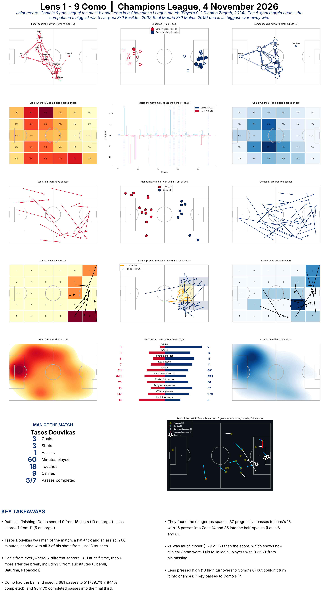

# Lens 1–9 Como — match report

Data analysis and visualisation of **Lens v Como** (UEFA Champions League 2026/27, league phase, 4 November 2026), built in Python from WhoScored event data using [`soccerdata`](https://github.com/probberechts/soccerdata) and [`mplsoccer`](https://mplsoccer.readthedocs.io/).

> **A record night.** Como's nine goals equal the **most ever scored by one team in a Champions League match**, matching Bayern Munich's 9–2 win over Dinamo Zagreb in 2024. The eight-goal margin equals the competition's **biggest win** (Liverpool 8–0 Beşiktaş, 2007; Real Madrid 8–0 Malmö, 2015), and it is the **biggest away win** in Champions League history.



## Read the notebooks

| Notebook | What it is | Open in nbviewer |
|---|---|---|
| `Match_Report.ipynb` | The finished report: every chart as a reusable `draw_...` function, combined into the figure above, with a man-of-the-match panel and key takeaways. | [View](https://nbviewer.org/github/SAJ011/Lens_v_Como-match-report/blob/main/Match_Report.ipynb) |
| `Lens_vs_Como.ipynb` | The working notebook. Downloads the match events and builds each chart step by step: shot map, passing networks, pass end zones, chance creation, progressive passes, Zone 14, high turnovers, expected threat, and Tasos Douvikas's performance. | [View](https://nbviewer.org/github/SAJ011/Lens_v_Como-match-report/blob/main/Lens_vs_Como.ipynb) |

Other files: `Lens_Como.csv` (the 1,736 match events, so the notebooks run without re-scraping), `match_report.png` (the full report) and `requirements.txt`.

## Key findings

- **Ruthless finishing:** Como scored 9 from 18 shots (13 on target). Lens scored 1 from 11 (5 on target).
- **Man of the match, Tasos Douvikas:** a hat-trick and an assist in 60 minutes. He scored with all 3 of his shots from just 18 touches.
- **Goals from everywhere:** 7 different scorers. Como led 3–0 at half-time and scored 6 more after the break, including 3 from substitutes (Liberali, Baturina, Papaccioli).
- **Como had the ball and used it:** 681 passes to 511 (89.7% v 84.1% completed), and 96 v 70 completed passes into the final third.
- **They found the dangerous spaces:** 37 progressive passes to Lens's 18, with 16 passes into Zone 14 and 35 into the half-spaces (Lens: 6 and 8).
- **xT was much closer than the score (1.79 v 1.17):** Como were clinical, not just dominant. Luis Milla led all players with 0.65 xT from his passing.
- **Lens pressed but couldn't create:** 13 high turnovers to Como's 8, but only 7 key passes to Como's 14.

## Methods in brief

- **Pitch:** Opta coordinates (0–100 on both axes). On shared pitches Como attack left → right and Lens are mirrored.
- **Progressive pass:** a completed pass (not a corner or throw-in) that ends at least 25% closer to goal than it started, with distances in metres (105 × 68 pitch).
- **Passing network:** average positions from completed passes before each team's first substitution; the receiver is taken as the player in the next event.
- **High turnover:** a ball recovery, interception or won tackle within 40 m of the opponent's goal.
- **Expected threat (xT):** a 12 × 8 xT grid ([source](https://github.com/mckayjohns/youtube-videos/blob/main/data/xT_Grid.csv)); each completed pass scores the xT of where it ended minus where it started (negative values set to 0).
- **Carries:** not in the data, so built from consecutive touches by the same team in the same half, after a successful action, covering 3–60 m.

## How to run

```bash
pip install -r requirements.txt
jupyter notebook Match_Report.ipynb
```

To download the data again, run section 1 of `Lens_vs_Como.ipynb` (it opens a browser window to scrape WhoScored).

## Record sources

- [Malay Mail / AFP: Como run riot with 9–1 thrashing of Lens to match Champions League record](https://malaymail.com/news/sports/2026/11/05/fabregas-como-run-riot-with-9-1-thrashing-of-lens-to-match-champions-league-record/242037)
- [bdnews24: Como equal the biggest victory in the competition's history](https://bdnews24.com/sport/oaimi0c483)
- [Diretta: the widest away win in Champions League history](https://www.diretta.it/news/como-da-record-il-9-1-al-lens-e-la-vittoria-esterna-piu-larga-della-storia-della-champions-league/z7YJ5noo/)
- [Free Press Journal: the records set by Bayern's 9–2 win over Dinamo Zagreb](https://www.freepressjournal.in/sports/explained-records-shattered-by-bayern-munich-harry-kane-after-9-2-win-against-dinamo-zagreb-in-uefa-champions-league)

## Licence

[MIT](LICENSE)
